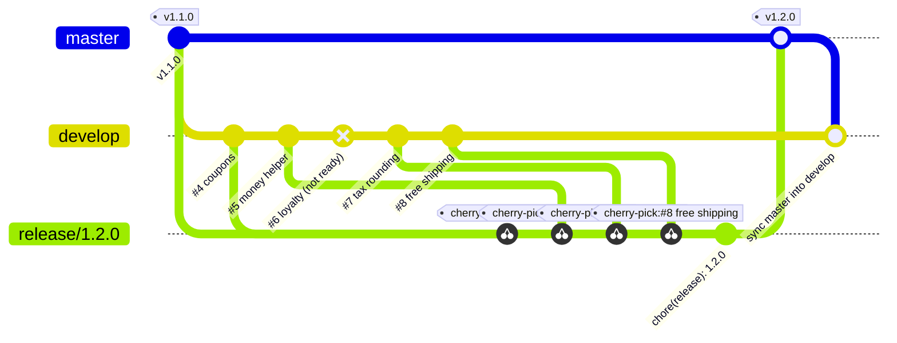

# Release process: full and selective releases

This guide is for repositories with a `master` branch (production) and a `develop` branch (integration).

**In short:** before each release, review what is in `develop`.

- If everything is validated for production, release `develop` as it is. This is a **full release**.
- If only some changes are validated, create the release branch from `master` and bring only those changes into it with `git cherry-pick -x`. This is a **selective release**.
- A change is never released without the changes it depends on.
- Releases are prepared by Claude Code with the prompts in [section 6](#6-doing-it-with-claude-code).

The commands work in Git Bash and in PowerShell. Values such as `1.2.0` and `#4` come from the [demo repository](../README.md).

---

## 1. Why the process changes

Until now, every release took the whole `develop` branch. We created `release/x.y.z` from `develop` and merged it into `master`. Every change merged into `develop` went to production, whether it was validated or not.

From now on, every release starts with a review. For each change waiting in `develop`, someone answers one question: is it validated for production?

| Result of the review | Flow | Create the release branch from |
| --- | --- | --- |
| Every change is validated | [Full release](#5-full-release) | `develop` |
| Only some changes are validated | [Selective release](#4-selective-release-step-by-step) | `master`, then cherry-pick |
| No change is validated | No release | none |

## 2. Branches

| Branch | Purpose | Created from | Merged into |
| --- | --- | --- | --- |
| `master` | Production. Each merge is a release, tagged `vX.Y.Z`. | | |
| `develop` | Integration of finished changes. | `master` | |
| `feature/*`, `fix/*`, `refactor/*` | One change. | `develop` | `develop`, by PR with **squash** |
| `release/X.Y.Z` | One release. | `develop` (full) or `master` (selective) | `master`, by PR with a **merge commit** |

After a release is merged into `master`, `master` is merged back into `develop` ([step 8](#step-8-after-the-merge-tag-and-sync-develop)).

In the diagram below, `develop` has five changes, but #6 is not validated. The release branch starts from `master` and receives only the other four:



## 3. Cherry-pick in one minute

`git cherry-pick <commit>` takes the change introduced by an existing commit and applies it to the current branch as a new commit. The new commit has the same change and the same message as the original, but a different SHA.

```bash
git cherry-pick -x <sha>                  # one commit
git cherry-pick -x <sha1> <sha2> <sha3>   # several commits, applied in the order given
git cherry-pick -x -m 1 <merge-sha>       # a merge commit: the whole merged PR as one commit
git cherry-pick --continue                # after resolving a conflict
git cherry-pick --abort                   # give up and go back to where you started
```

`-x` adds the line `(cherry picked from commit <original sha>)` to the message. **Always use it.** Later, this line is how we find out which commits from `develop` are already in production.

## 4. Selective release, step by step

The values in this section come from the demo: version `1.2.0`, PRs #4, #5, #7 and #8 validated, PR #6 not validated.

### Step 1: list what is waiting in develop

```bash
git fetch origin
git log --oneline --reverse --no-merges origin/master..origin/develop
```

This lists the commits that are in `develop` but not in `master`, oldest first. When feature PRs are squash-merged, each line is one PR, for example `feat: discount coupons (#4)`.

A cherry-picked copy has a different SHA from its original. So commits that an earlier selective release already put in production still appear in this list. To see which ones they are:

```bash
git log origin/master --grep "cherry picked from commit" --format="%h %s"
```

If a commit from the first list has its title in this second list, it is already in production.

### Step 2: decide what is ready

Check each change against its status in Jira or QA, and write down which changes are ready and which are not.

### Step 3: check the dependencies

A change **B** depends on an earlier change **A** in three cases:

1. **B changes lines that A added or changed.** Cherry-picking B without A stops with a conflict.
2. **B uses something that A introduced**, such as a function, class, file, database migration or column, configuration key or package. The cherry-pick can apply cleanly while the build or the application breaks.
3. **B only makes sense with A's behavior.** This is a business dependency: git cannot see it.

To find the candidates:

```bash
git show --stat <sha-B>
git log --oneline --reverse origin/master..<sha-B>^ -- $(git show --name-only --format= <sha-B>)
git show <sha-B>
```

- The first command lists the files that B changes.
- The second lists the earlier pending commits that changed those same files. Each one is a possible dependency: open it and decide.
- The third shows B's diff. Look for new imports or usings, calls to new code, migrations and configuration keys.

Rules:

1. If B depends on A and A is ready, include A before B.
2. If B depends on A and A is **not** ready, B cannot be released either. Wait for A, or ask the authors to separate the two changes.
3. Keep the original order of `develop`: oldest first.
4. A missing dependency does not always cause a conflict. Always build and test the release branch.

### Step 4: create the release branch from master

```bash
git switch -c release/1.2.0 origin/master
```

### Step 5: cherry-pick, oldest first

```bash
git cherry-pick -x <sha-4> <sha-5> <sha-7> <sha-8>
```

If git stops with a conflict, `git status` lists the conflicting files as `both modified`. During a selective release, a conflict usually means a missing dependency. To find the left-out commit that touched those lines:

```bash
git log --oneline origin/master..origin/develop -- <conflicting file>
```

Then choose one of two options:

- Run `git cherry-pick --abort`. If the missing commit is ready, add it to the list and start again.
- Resolve the conflict by hand, then run `git add <file>` and `git cherry-pick --continue`. Only do this if you are sure the conflict is context and not a dependency.

If a feature PR was merged with a merge commit instead of a squash, run `git cherry-pick -x -m 1 <merge-sha>`. It brings the whole PR as one commit. `-m 1` computes the change against the first parent of the merge, which is `develop`.

### Step 6: build, test and set the version

```bash
npm test
```

Use the commands of the project, for example `dotnet build` and `dotnet test`. Then update the version (`package.json`, `.csproj` and so on) and the `CHANGELOG.md` in a single commit:

```bash
git commit -am "chore(release): 1.2.0"
```

### Step 7: push and open the pull request

```bash
git push -u origin release/1.2.0
gh pr create --base master --head release/1.2.0 --title "Release 1.2.0" --body "Included: #4, #5, #7, #8. Left out: #6 (not validated)."
```

In the description, list the included changes, the changes left out and the dependencies you found.

Merge the PR with **Create a merge commit**, not with squash or rebase. A merge commit keeps the individual commits in `master`, and each one keeps its `cherry picked from commit` line.

### Step 8: after the merge, tag and sync develop

```bash
git fetch origin
git tag -a v1.2.0 origin/master -m "Release 1.2.0"
git push origin v1.2.0

git switch -c sync/master-into-develop-1.2.0 origin/develop
git merge --no-ff origin/master -m "Merge master into develop after 1.2.0"
npm test
git push -u origin sync/master-into-develop-1.2.0
gh pr create --base develop --title "Sync master into develop after 1.2.0" --body "Brings the 1.2.0 release back into develop."
```

The sync brings the new version number, the changelog and any fix made on the release branch into `develop`. Without it, the next release from `develop` conflicts with `master`. The merge is usually clean, because each cherry-picked change is identical to its original in `develop`. Merge this PR with **Create a merge commit** too.

## 5. Full release

Use this flow when every change in `develop` is validated:

```bash
git fetch origin
git log --oneline --reverse --no-merges origin/master..origin/develop
git switch -c release/1.2.0 origin/develop
npm test
git commit -am "chore(release): 1.2.0"
git push -u origin release/1.2.0
gh pr create --base master --head release/1.2.0 --title "Release 1.2.0" --body "Full release of develop."
```

1. The `git log` command lists the pending changes. Confirm that every one of them is validated.
2. Before the `git commit`, update the version and the changelog.
3. After the merge, follow [step 8](#step-8-after-the-merge-tag-and-sync-develop).

## 6. Doing it with Claude Code

From now on, releases are prepared by Claude Code, not created by hand. Claude Code lists what is pending, checks the dependencies, cherry-picks, runs the tests and opens the pull request. You decide what goes in and review the pull request.

### Prerequisites

1. Claude Code is installed: `claude --version`.
2. The GitHub CLI is logged in: `gh auth status`.
3. The repository is cloned, and the terminal is at its root.
4. The working tree is clean: `git status`.

### How to use a prompt

1. Open a terminal at the root of the repository and run `claude`.
2. Copy one of the prompts below, replace the values between `<` and `>`, paste it and press Enter.
3. Claude Code shows its analysis or plan and waits for you. Check the dependencies and the changes left out, then answer, for example `confirmed` or `drop #8`.
4. Before running a command, Claude Code asks for permission, unless your settings already allow that command. Read each command before you allow it.
5. At the end, Claude Code replies with the pull request link. Review the pull request, get it approved, and merge it with **Create a merge commit**.
6. After the merge, run the [prompt to finish the release](#64-prompt-finish-a-release-after-the-merge).

You can also write the prompts in Portuguese. Keep the rules.

### 6.1 Prompt: what is waiting in develop

Use this prompt before deciding what goes into a release. It changes nothing in the repository.

```text
Show me what is waiting in develop to be released to master in this repository.
Do not create branches, commits, tags or pull requests.

1. Run `git fetch origin` and list the commits in `origin/develop` that are not in `origin/master`, oldest first, ignoring merge commits.
2. Mark as "already released" every commit whose change is already in `origin/master`: an equivalent patch, or a commit in `origin/master` whose message says "cherry picked from commit <sha>" with that commit's SHA.
3. For each commit not released yet, show: short SHA, title, pull request number and link, author, date, files changed and, if the pull request exists on GitHub, its labels.
4. For each of them, list the earlier unreleased commits it depends on, and why: it changes the same lines, or it uses code, files, database migrations, configuration or packages that they introduce.
5. End with a table and a short summary: which changes can be released on their own, and which can only go together.
```

### 6.2 Prompt: selective release

```text
Prepare a selective release in this repository.
Version: <VERSION, e.g. 1.2.0>
Changes to release: <pull request numbers, Jira keys or commit SHAs, e.g. #4, #5, #7, #8>

Rules:
1. Run `git fetch origin` and work from `origin/master` and `origin/develop`. If the working tree has uncommitted changes, or `release/<VERSION>` already exists locally or on origin, stop and tell me.
2. List the commits in `origin/develop` that are not in `origin/master`, oldest first, ignoring merge commits. Leave out the ones whose change is already in `origin/master` (an equivalent patch, or a commit in `origin/master` whose message says "cherry picked from commit <sha>").
3. Find the commit or commits of each change I asked for, by pull request number, Jira key or SHA. If a change is not found, is already released or matches more than one candidate, stop and ask me.
4. Check dependencies. For each selected commit, check every earlier pending commit that I did not select: does the selected commit change lines it changed, or use code, files, database migrations, configuration or packages it introduced? If a selected change depends on one I did not select, stop and ask me whether to add it or to drop the change. Never add a commit I did not approve.
5. Show me the plan and wait for my confirmation: the branch name, the commits to cherry-pick in order (SHA, title, pull request), the pending commits left out, and the dependencies found with the reason for each.
6. After I confirm:
   a. Create `release/<VERSION>` from `origin/master`.
   b. Cherry-pick the commits in their original order with `git cherry-pick -x` (for a merge commit, `git cherry-pick -x -m 1`).
   c. If a cherry-pick stops with a conflict, do not resolve it by guessing: show me the conflicting files and the left-out commit that most likely causes the conflict, and wait for my decision.
   d. Build the project and run the tests. If anything fails, stop and show me the failure.
   e. Update the version to <VERSION> and the changelog, following the conventions of this repository, in a single commit "chore(release): <VERSION>". If the repository has neither, skip this step and tell me.
   f. Push `release/<VERSION>` and open a pull request into `master` titled "Release <VERSION>". The description lists the included changes (with pull request links), the pending changes left out, and the dependencies found.
7. Never push to `master` or `develop`, never force-push, and never merge the pull request. When you finish, switch back to the branch I was on and reply with the pull request link and a summary.
```

### 6.3 Prompt: full release

```text
Prepare a full release in this repository: everything in develop goes to master.
Version: <VERSION, e.g. 1.2.0>

Rules:
1. Run `git fetch origin`. If the working tree has uncommitted changes, or `release/<VERSION>` already exists locally or on origin, stop and tell me.
2. List the commits in `origin/develop` that are not in `origin/master`, oldest first, with their pull request numbers, and wait for me to confirm that all of them are ready for production.
3. After I confirm, create `release/<VERSION>` from `origin/develop`, build the project and run the tests. If anything fails, stop and show me the failure.
4. Update the version to <VERSION> and the changelog, following the conventions of this repository, in a single commit "chore(release): <VERSION>".
5. Push `release/<VERSION>` and open a pull request into `master` titled "Release <VERSION>", listing the included changes with pull request links.
6. Never push to `master` or `develop`, never force-push, and never merge the pull request. When you finish, switch back to the branch I was on and reply with the pull request link.
```

### 6.4 Prompt: finish a release after the merge

```text
The pull request of release <VERSION> was merged into master. Finish the release in this repository.

1. Run `git fetch origin` and check that `origin/master` contains `release/<VERSION>`. If it does not, stop and tell me.
2. Create the annotated tag `v<VERSION>` on the merge commit of `release/<VERSION>` in `origin/master`, with the message "Release <VERSION>", and push it.
3. Create `sync/master-into-develop-<VERSION>` from `origin/develop` and merge `origin/master` into it with `git merge --no-ff`. Resolve conflicts in the version and changelog files by keeping the version of master and every changelog entry; for any other conflict, stop and ask me. Build the project and run the tests.
4. Push the branch and open a pull request into `develop` titled "Sync master into develop after <VERSION>".
5. Never push to `master` or `develop` and never force-push. Reply with the tag, the pull request link, and a reminder to merge that pull request with "Create a merge commit" (not squash). Ask me before deleting the `release/<VERSION>` branch.
```

### 6.5 Optional: save a prompt as a slash command

A Claude Code skill saves a prompt so that you can run it as a slash command:

| Location | Available in |
| --- | --- |
| `~/.claude/skills/<name>/SKILL.md` (Windows: `%USERPROFILE%\.claude\skills\<name>\SKILL.md`) | Every repository on your machine |
| `.claude/skills/<name>/SKILL.md`, committed to the repository | Everyone who works on that repository |

For example, save this as `~/.claude/skills/selective-release/SKILL.md`:

```markdown
---
name: selective-release
description: Prepare a selective release - a release branch from master with only the chosen changes from develop.
argument-hint: <version> <changes to release>
disable-model-invocation: true
---

Prepare a selective release in this repository.
Request: $ARGUMENTS
The first value of the request is the version (written <VERSION> below); the rest are the changes to release (pull request numbers, Jira keys or commit SHAs).

Rules:
(paste rules 1 to 7 of prompt 6.2 here)
```

Then run it from Claude Code:

```text
/selective-release 1.2.0 PRs 4, 5, 7 and 8
```

- `$ARGUMENTS` is replaced by everything typed after the command.
- `disable-model-invocation: true` means the skill runs only when someone types the command. Claude Code never starts a release on its own.
- The other prompts can be saved the same way, for example as `/release-status`, `/full-release` and `/finish-release`.

Reference: [Claude Code skills](https://code.claude.com/docs/en/skills).

## 7. Rules

1. Never commit or push directly to `master`.
2. A release branch reaches `master` only through a pull request, merged with a merge commit.
3. A selective release starts from `master` and receives the changes with `git cherry-pick -x`, oldest first.
4. A change goes with all its dependencies, or it does not go.
5. Before opening the pull request, the release branch must build and pass the tests.
6. After the merge, tag the release and sync `master` into `develop`.
7. Squash-merge feature PRs into `develop`. With one commit per PR, a selective release is one cherry-pick per change.

## 8. Cheat sheet

| Goal | Command |
| --- | --- |
| List what is waiting in develop | `git log --oneline --reverse --no-merges origin/master..origin/develop` |
| List what was already released by cherry-pick | `git log origin/master --grep "cherry picked from commit" --format="%h %s"` |
| List the files a commit changes | `git show --stat <sha>` |
| List earlier pending commits that touched the same files | `git log --oneline --reverse origin/master..<sha>^ -- $(git show --name-only --format= <sha>)` |
| Create a selective release branch | `git switch -c release/X.Y.Z origin/master` |
| Bring commits into the release | `git cherry-pick -x <sha1> <sha2> ...` |
| Bring a PR that was merged with a merge commit | `git cherry-pick -x -m 1 <merge-sha>` |
| Continue after resolving a conflict | `git add <file>` then `git cherry-pick --continue` |
| Give up a cherry-pick | `git cherry-pick --abort` |
| Open the release pull request | `gh pr create --base master --title "Release X.Y.Z"` |
| Tag the release | `git tag -a vX.Y.Z origin/master -m "Release X.Y.Z"` then `git push origin vX.Y.Z` |
